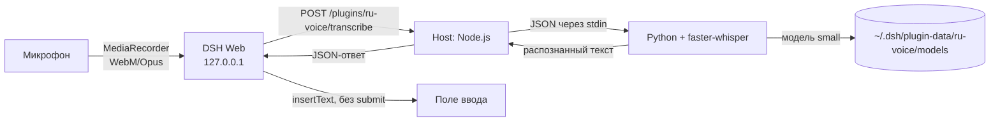

# 🎙 Русский голосовой ввод для DeepSeek Harness

[](LICENSE)
[](INSTALL_PROMPT.md)
[](https://www.python.org/)
[](https://github.com/SYSTRAN/faster-whisper)
[](#офлайн-режим)

Локальная диктовка на русском прямо в поле ввода DeepSeek Harness: говорите — фразы
появляются в черновике по мере речи. Без облака, без API-ключей и **без автоотправки**.


---

## Возможности

- 🎤 **Кнопка микрофона у поля ввода** — рядом с кнопкой отправки, ничего не нужно искать в меню.
- ⚡ **Фразовый стриминг** — текст дописывается после каждой паузы (~0,7 с), а не только по кнопке «стоп».
- 🔒 **Полностью локально** — faster-whisper `small` работает на CPU хоста; после первой установки интернет не нужен.
- ✍️ **Пунктуация из коробки** — Whisper расставляет запятые, точки, заглавные буквы; модель получает подсказку про знаки препинания.
- 🚫 **Без автоотправки** — плагин только вставляет текст в черновик, отправляете вы сами.
- 🧰 **Самоустановка окружения** — при первом запуске сам создаёт venv, ставит зависимости и скачивает модель.
- 🌍 **Локализация** — подписи на русском, английском и китайском.
- ⚙️ **Настройка под машину** — модель, число потоков, beam search, каталог данных и путь к Python.

## Как это работает



- Запись идёт непрерывно; по тишине фраза нарезается и уходит на распознавание.
- На хосте живёт один «тёплый» Python-процесс: модель загружается один раз и держится в памяти.
- Текст вставляется в позицию курсора через штатный `inputActions.insertText()` — это обычная
  правка черновика, а не отправка сообщения.

## Требования

| Компонент | Требование |
|---|---|
| DeepSeek Harness | Desktop или Web, профиль с веб-интерфейсом |
| Python | 3.9–3.13 (на Windows подойдёт встроенный Python DSH) |
| Сеть | только для первой установки: PyPI и Hugging Face |
| Диск | ~750 МБ (venv + модель `small`) |
| ОС | Проверено на Windows 11; macOS/Linux поддерживаются кодом, но не тестировались |

## Установка

1. Клонируйте репозиторий в удобную папку:

   ```bash
   git clone https://github.com/fiast/deepseek-harness-russian-voice-input.git
   ```

2. Установите бандл в DSH:

   **Через интерфейс (рекомендуется):** Settings → Plugins → установка плагина из папки →
   выберите папку репозитория `deepseek-harness-russian-voice-input`.

   **Через CLI (если папка уже склонирована):**

   ```bash
   dsh plugin --profile <профиль> add "link:/абсолютный/путь/к/репозиторию"
   ```

   После установки бандл `@local/ru-voice-input` появится в списке плагинов — включите его.

3. Подождите первого запуска. В статусе будет видно подготовку:

   ```powershell
   Invoke-WebRequest http://127.0.0.1:<порт>/plugins/ru-voice/status | Select-Object -Expand Content
   # {"ready":true,"warm":true,"model":"small"}
   ```

   Первый запуск занимает несколько минут: создаётся venv, ставятся зависимости и
   скачивается модель (~464 МБ). Пока идёт подготовка, кнопка показывает «Распознавание ещё готовится».

4. Нажмите микрофон и говорите. Кнопка ещё раз — закончить диктовку.

### Установка через промпт

Если не хочется клонировать и включать бандл вручную, отдайте установку ИИ-агенту
DeepSeek Harness. Вставьте в чат:

```text
Установи плагин русского голосового ввода по инструкции:
https://github.com/fiast/deepseek-harness-russian-voice-input/blob/main/INSTALL_PROMPT.md
```

Агент сам склонирует репозиторий в `~/.dsh/bundles/ru-voice-input`, установит бандл через
Plugin Manager, дождётся загрузки модели и проверит, что кнопка микрофона зарегистрирована.
Полный текст с шагами, проверками и разбором ошибок — в [`INSTALL_PROMPT.md`](INSTALL_PROMPT.md).
Потребуется разрешение на установку бандла.

### Обновление

```bash
git pull
```

и перезапустите плагин в DSH (или DSH целиком).

## Настройка

Все поля необязательны. Конфигурация задаётся строкой плагина в
`$DSH_HOME/profiles/<профиль>/cordis.patch.yml`:

```yaml
- id: ru-voice-input
  config:
    model: small          # tiny | base | small | medium
    threads: 8            # потоков CPU; 0 — подобрать автоматически
    beamSize: 1           # 1 — жадно и быстро; 5 — чуть точнее
    # dataRoot: D:\dsh-data\ru-voice
    # pythonPath: C:\Python312\python.exe
```

| Поле | По умолчанию | Назначение |
|---|---|---|
| `model` | `small` | модель faster-whisper; `base` быстрее, но ошибается в словах |
| `threads` | `0` (до 8) | число потоков; больше 8 на гибридных CPU обычно медленнее |
| `beamSize` | `1` | beam search; 1 — жадное декодирование |
| `dataRoot` | `~/.dsh/plugin-data/ru-voice` | venv, кэш модели, отметка готовности |
| `pythonPath` | автопоиск | интерпретатор Python 3 для создания venv |

Готовый пример лежит в [`examples/cordis.patch.yml`](examples/cordis.patch.yml).

## Производительность

Распознавание идёт на CPU: CTranslate2 не использует встроенную графику (Iris Xe и т.п.),
а CUDA-карты нужны отдельно. Ориентиры на i5-1335U (2P + 8E, 15 Вт):

| Настройки | Фраза 3,8 с | Фраза 8,4 с |
|---|---|---|
| 4 потока, beam 5 | ~5,3 с | ~7,2 с |
| **8 потоков, beam 1** | **~2,7 с** | **~2,8 с** |
| `base`, 8 потоков, beam 1 | — | ~1,3 с |

Особенность Whisper: он всегда обрабатывает окно 30 секунд, поэтому короткая фраза стоит
почти столько же, сколько длинная (~2,5 с на фразу). Диктуйте более крупными фразами —
фиксированная цена амортизируется.

Чтобы ускорить:

- `threads: 8` (уже по умолчанию) и `beamSize: 1`;
- схема питания «Высокая производительность» и питание от сети;
- закрыть тяжёлые приложения — инференс занимает все доступные ядра.

## Офлайн-режим

После первой установки плагин работает без интернета:

- модель и venv лежат на диске;
- при наличии кэша модель загружается с `local_files_only=True` — обращений к Hugging Face нет;
- браузер общается только с `127.0.0.1`.

Проверено с принудительно отключённым Hugging Face (`HF_HUB_OFFLINE=1`): фраза на 6 секунд
распознана за 2,95 с. Интернет нужен только для первичной установки и, разумеется, для ответов
самого DeepSeek в чате.

## Частые проблемы

| Симптом | Что делать |
|---|---|
| «Распознавание ещё готовится» долго | Первый запуск качает ~464 МБ; смотрите `phase` в `/plugins/ru-voice/status` |
| «Не найден Python 3» | Укажите `pythonPath` в конфиге (Python 3.9–3.13) |
| «Не удалось подготовить распознавание» | Проверьте доступ к PyPI/Hugging Face, место на диске и текст `error` в статусе |
| «Доступ к микрофону запрещён» | Разрешите микрофон для страницы DSH в настройках браузера |
| Ошибка `metadata_errors` | Установилась несовместимая PyAV; плагин ставит `av<19` сам, при ручной установке — `pip install "av<19"` |
| Распознаёт слишком медленно | `threads: 8`, `beamSize: 1`, питание от сети; см. раздел «Производительность» |
| Нет текста, хотя речь была | Проверьте уровень микрофона и устройство ввода в системе; порог тишины — 0,7 с |

## Структура репозитория

| Файл | Назначение |
|---|---|
| `package.json` | Манифест бандла, Client-секция, экспорты |
| `cordis.patch.yml` | Строка плагина в профиле DSH |
| `index.js` | Host: HTTP-маршруты, установка окружения, тёплый Python-процесс |
| `transcribe.py` | faster-whisper: декодирование аудио, распознавание, пунктуация |
| `client.js` | Кнопка микрофона, MediaRecorder, VAD, вставка текста |
| `locale/*.json` | Название и описание плагина для Plugin Manager |
| `icon.svg` | Иконка плагина |
| `examples/cordis.patch.yml` | Пример конфигурации |
| `INSTALL_PROMPT.md` | Готовый промпт: агент сам устанавливает плагин в другом DSH |
| `requirements.txt` | Зависимости для ручной установки |

### API плагина

- `GET /plugins/ru-voice/status` — `{ ready, phase, message, error, model, warm }`.
- `POST /plugins/ru-voice/transcribe` — тело: аудио (`audio/*`); ответ:
  `{ text, durationSeconds, elapsedSeconds, maxSeconds }`;
  пока идёт подготовка — `503`.

## Разработка

```powershell
# зависимости вручную (обычно не нужно — плагин ставит их сам)
python -m venv .venv
.venv\Scripts\pip install -r requirements.txt

# проверка синтаксиса
node --check client.js
node --check index.js
python -m py_compile transcribe.py

# прямая проверка распознавания файлом
python transcribe.py --stdin < sample.webm
```

Плагин ставит `av<19`: в PyAV 19 удалён параметр `metadata_errors`, который faster-whisper 1.2
передаёт в `av.open()`.

## Лицензия

[MIT](LICENSE) © 2026 fiast

Модель Whisper распространяется отдельно под лицензией MIT (OpenAI / Systran faster-whisper);
в репозиторий веса не входят.
